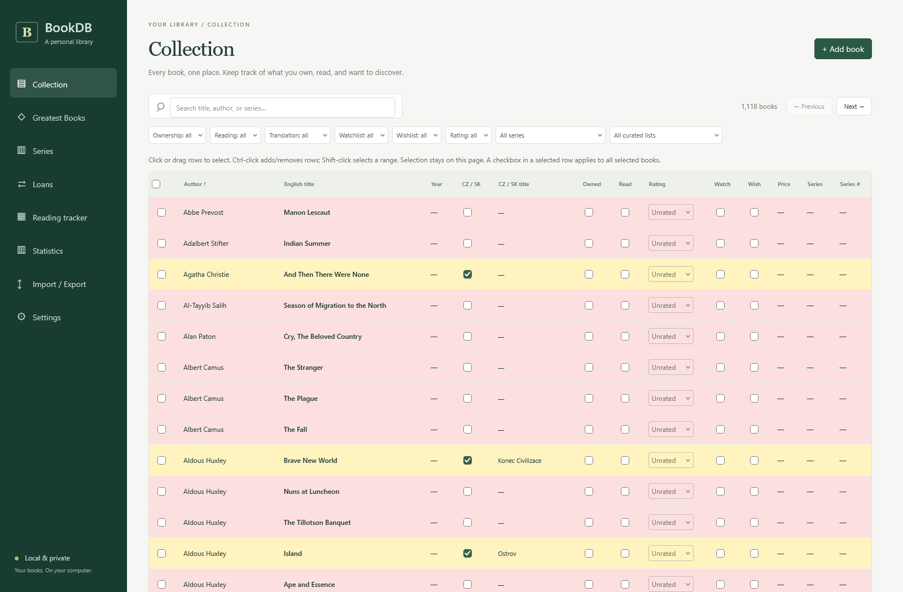
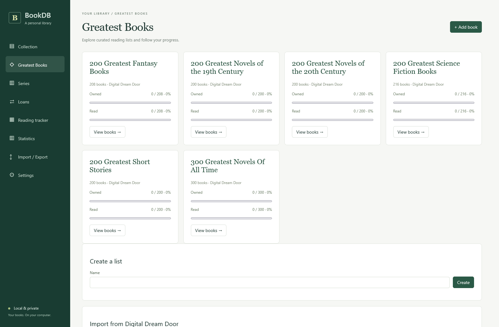

# BookDB 1.8.0 for Windows

An offline personal book catalogue with English, Czech and Slovak interfaces,
curated lists, series, loans and a reading tracker.

## Application

Download and extract [BookDB-1.8.0-Windows.zip](https://github.com/mkd0147/book_db/releases/download/v1.8.0/BookDB-1.8.0-Windows.zip). Keep the entire BookDB folder
together, then open `BookDB/BookDB.exe`. Python and Node are not required.
The application opens in your default browser and stores data locally.
This is the unchanged Windows 1.8.0 release. Android and cloud synchronization
are not included. This repository distributes the frozen application and a starting catalogue;
it does not contain the exact v1.8.0 application source snapshot.

## Optional starting catalogue

`catalogue/books.db` contains 1,118 books, 30 series and 6 curated lists,
including ranked memberships and Czech/Slovak translation information.
Books retain shared IDs across lists. Source links are retained for attribution.

Ownership, read status, ratings, prices, wishlists, watchlists, notes, borrower
information, loan history and reading sessions are absent or reset. Record
timestamps use a fixed neutral value. List descriptions are excluded.
The database was created afresh from allowed fields, not by deleting private
records from a copy of the original file.

To try the catalogue separately, copy `catalogue/books.db` into a new folder,
for example `C:\BookDB-Catalogue`, and launch from PowerShell:

```powershell
.\BookDB\BookDB.exe --data-dir C:\BookDB-Catalogue --port 8769
```

Do not overwrite an existing personal database. Changes affect your local
copy only. The catalogue is separate from the unchanged application archive.

## Screenshots

Actual v1.8 Windows interface, shown with the public catalogue and no personal data.





## Local storage and removal

By default, your database is stored at `%LOCALAPPDATA%\BookDB\books.db`,
separately from the application folder. Settings shows the actual location.
Use Import / Export to export YAML backups before changing or moving a library.
Closing the browser does not stop the application: use the launcher to stop it.

To remove the portable application, stop BookDB and delete its extracted folder.
Your database remains in its data folder. Delete that folder separately only if
its contents are no longer needed and you have retained any wanted backups.

## Release transparency

The v1.8 executable is currently unsigned. Checksums detect changed downloads;
they do not certify publisher identity or software safety. Do not disable
Windows security protections to run this application.

The exact source snapshot used to build v1.8 was not preserved. The current
repository is therefore a binary distribution with catalogue export tooling,
not a reproducible source release. A future release needs matching source and
build instructions before we can claim source-to-binary traceability.

See [code signing status](docs/CODE_SIGNING.md).
